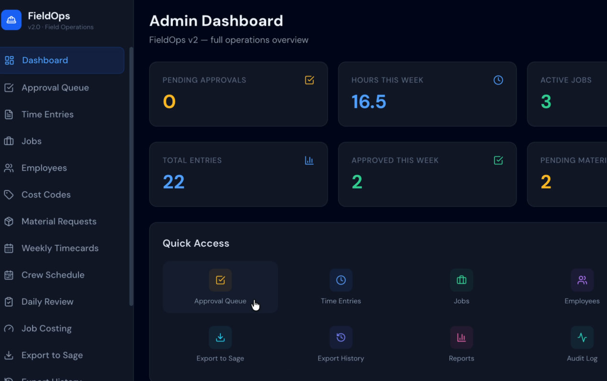

# Stryda

**Stryda** is a full-stack construction operations platform for small-to-mid contractors. It connects crew scheduling, worker time tracking, supervisor daily review, weekly payroll approval, job costing, and Sage-ready payroll workflows into one clean system.

Stryda is designed to help contractors move from field work to clean payroll and job-cost visibility without relying on paper timecards, text messages, spreadsheets, or disconnected tools.

---

## Demo Video

<p align="center">
  <a href="https://youtu.be/mNq2MaEQ_AQ" target="_blank">
    
  </a>
</p>

<p align="center">
  🎥 <strong>Click the image above to watch the demo on YouTube</strong><br>
  <sub>(Tip: Ctrl/Cmd + Click to open in a new tab)</sub>
</p>


---

## Why Stryda

Many small contractors use Sage for payroll but still collect field time by text, paper, or spreadsheet. That causes slow payroll prep, wrong job codes, overtime found too late, and no record of who changed what. Stryda collects time on a phone, checks it as it is entered, routes it through approval, and produces a CSV that Sage can import.

---

## Workflow

```text
Worker logs or clocks hours  ->  Supervisor reviews the day  ->  Admin approves the week
  ->  Admin locks payroll  ->  Admin downloads the Sage CSV
```

Every approval, edit, rejection, lock, and export writes a record to the audit log.

---

## Features

- **Worker:** today's assignment, clock in and out, log hours, week at a glance, correction requests, mobile friendly layout.
- **Supervisor:** daily review of scheduled vs actual time, approval queue, daily sign-off.
- **Admin:** weekly timecards, payroll lock and unlock, jobs, employees, cost codes, company settings, audit log, reports, Sage CSV export and export history.
- **Overtime:** regular, overtime, and double time hours are classified from configurable company settings. The default is federal: overtime over 40 hours in a workweek.
- **Safety checks:** 16 hour cap per entry, no future dates, 14 day lookback, duplicate submission window, approved entries locked from worker edits, role checks on every API route.

### Sage integration

Stryda exports a **Sage-ready CSV**. There is no live Sage API sync, by design. The Export to Sage page filters approved entries by date and job, shows a preview, and downloads the file. The "mark as exported" box is checked by default, which marks the entries as exported when the file is generated. Uncheck it to download without changing entry status.

---

## Tech Stack

- **Frontend:** React, Vite, Tailwind CSS
- **Backend:** Python, FastAPI, SQLAlchemy, JWT authentication
- **Database:** SQLite for local development, PostgreSQL in production
- **Tests and CI:** pytest, GitHub Actions

---

## Run it locally

Requirements: Python 3.11, Node 20.

### 1. Backend

```bash
cd backend
python3 -m venv .venv
source .venv/bin/activate
pip install -r requirements.txt

export STRYDA_ENV=dev        # required for local development
python seed.py               # creates demo users and sample data
uvicorn main:app --reload --port 8000
```

API docs: http://localhost:8000/docs

### 2. Frontend

In a second terminal:

```bash
cd frontend
npm install
npm run dev
```

App: http://localhost:3000 (the dev server proxies `/api` to port 8000).

### Demo logins (local development only)

| Role | Email | Password |
|---|---|---|
| Admin | admin@fieldops.com | admin123 |
| Supervisor | supervisor@fieldops.com | super123 |
| Worker | worker1@fieldops.com | work123 |

These exist only in the local seed data. Never use them in production.

---

## Environment variables

| Variable | Used by | Notes |
|---|---|---|
| `STRYDA_ENV` | backend | `dev` for local work. Anything else is treated as production. |
| `SECRET_KEY` | backend | Required unless `STRYDA_ENV=dev`. |
| `CORS_ORIGINS` | backend | Comma separated frontend origins. Required unless `STRYDA_ENV=dev`. |
| `DATABASE_URL` | backend | Defaults to a local SQLite file. Use a PostgreSQL URL in production. |
| `VITE_API_URL` | frontend build | Backend base URL in production, no trailing slash. |

Secrets belong in environment variables, never in the repository or the frontend.

---

## Tests

```bash
cd backend
STRYDA_ENV=dev python -m pytest -q
```

The suite covers entry validation, overtime and double time classification, role permissions, audit records, payroll locking, Sage CSV export, and a three pay period accuracy check against hand calculated totals (synthetic data). GitHub Actions runs the backend compile check and tests, plus the frontend build, on every push.

---

## Guides

- [Admin and payroll guide](docs/ADMIN_GUIDE.md)
- [Worker quick guide](docs/WORKER_QUICK_GUIDE.md)

---

## Known limitations

- Sage is CSV only. The CSV has total hours per entry; it does not split regular and overtime hours.
- Overtime breakdown is shown on the worker dashboard for the current week.
- Pilot results with Calray Electric are still being collected.

---

## Author

Built by **Eli Ortiz** as a CSIT4100 capstone project at Graceland University.
